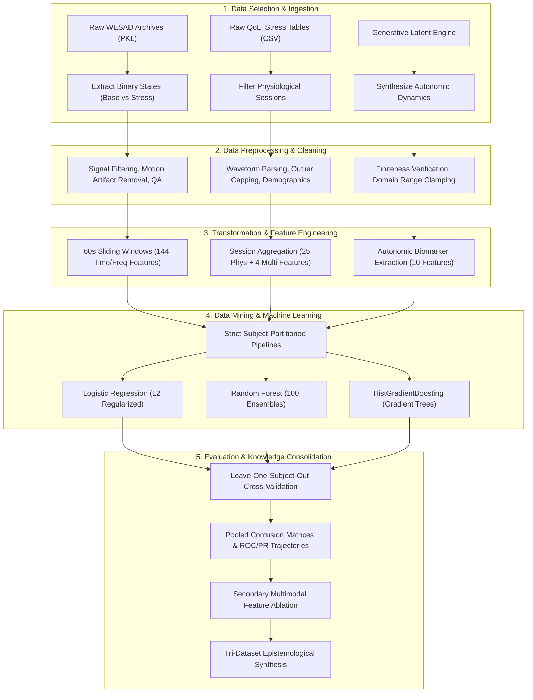

# Predicting Human Stress Level From Physiological Signals Using Machine Learning

[](https://www.python.org/)
[](https://scikit-learn.org/)
[](https://www.kdd.org/)
[](https://scikit-learn.org/stable/modules/cross_validation.html)

An end-to-end, reproducible predictive analytics study investigating the feasibility, subject-independent generalization, and empirical boundaries of machine learning models for detecting acute human stress states from non-invasive peripheral physiological signals.

Developed for **Predictive Analytics (CA-3)**, this repository evaluates laboratory-grade telemetry, consumer wearable stress-induction data, and a parametric synthetic benchmark using strict **Leave-One-Subject-Out (LOSO)** cross-validation to prevent subject identity leakage.

---

## Table of Contents

- [1. Executive Summary & Problem Statement](#1-executive-summary--problem-statement)
- [2. Research Objectives & Questions](#2-research-objectives--questions)
- [3. Datasets & Physiological Modalities](#3-datasets--physiological-modalities)
  - [3.1 WESAD (Wearable Stress and Affect Detection)](#31-wesad-wearable-stress-and-affect-detection)
  - [3.2 QoL_Stress (Controlled Consumer Wearable Stress Induction)](#32-qol_stress-controlled-consumer-wearable-stress-induction)
  - [3.3 Synthetic_Stress (Controlled In-Silico Benchmark)](#33-synthetic_stress-controlled-in-silico-benchmark)
  - [3.4 Comparative Dataset Architecture](#34-comparative-dataset-architecture)
- [4. KDD Predictive Modeling Workflow](#4-kdd-predictive-modeling-workflow)
- [5. Notebook Guide & Artifact Walkthrough](#5-notebook-guide--artifact-walkthrough)
  - [Notebook 01: WESAD Preprocessing & Feature Engineering](#notebook-01-wesad-preprocessing--feature-engineering)
  - [Notebook 02: QoL_Stress Preprocessing & Psychometrics](#notebook-02-qol_stress-preprocessing--psychometrics)
  - [Notebook 03: Model Training, Evaluation & Comparison](#notebook-03-model-training-evaluation--comparison)
  - [Notebook 04: Synthetic Benchmark & Epistemological Evaluation](#notebook-04-synthetic-benchmark--epistemological-evaluation)
- [6. Machine Learning Architectures](#6-machine-learning-architectures)
- [7. Empirical Evaluation Results](#7-empirical-evaluation-results)
  - [7.1 Track A: Laboratory Benchmark (WESAD)](#71-track-a-laboratory-benchmark-wesad)
  - [7.2 Track B: Controlled Consumer Wearable Benchmark (QoL_Stress)](#72-track-b-controlled-consumer-wearable-benchmark-qol_stress)
  - [7.3 Secondary Multimodal Feature Ablation (QoL_Stress)](#73-secondary-multimodal-feature-ablation-qol_stress)
  - [7.4 Track C: Supplementary Synthetic Benchmark (Synthetic_Stress)](#74-track-c-supplementary-synthetic-benchmark-synthetic_stress)
  - [7.5 Tri-Dataset Synthesis Matrix](#75-tri-dataset-synthesis-matrix)
- [8. Methodological Safeguards & Leakage Prevention](#8-methodological-safeguards--leakage-prevention)
- [9. Repository Structure](#9-repository-structure)
- [10. Environment Setup & Execution Guide](#10-environment-setup--execution-guide)
  - [Raw Dataset Acquisition (Optional for Full Reprocessing)](#raw-dataset-acquisition-optional-for-full-reprocessing)
- [11. Methodological Limitations & Epistemological Boundaries](#11-methodological-limitations--epistemological-boundaries)
- [12. Ethical Considerations and Data Governance](#12-ethical-considerations-and-data-governance)
- [13. Academic Citations & References](#13-academic-citations--references)
- [14. Conclusion](#14-conclusion)

---

## 1. Executive Summary & Problem Statement

Psychological stress activates the autonomic nervous system (ANS), triggering sympathetic arousal (increased heart rate, elevated electrodermal activity, reduced heart rate variability) and parasympathetic withdrawal. While prolonged distress represents a pervasive risk factor for cardiovascular disease, metabolic syndrome, and mental health disorders, traditional clinical assessment relies predominantly on retrospective, subjective self-reports (such as the Perceived Stress Scale or State-Trait Anxiety Inventory), which are susceptible to recall bias and lack continuous temporal resolution.

Recent advancements in wearable biosensors present an opportunity for objective, continuous stress monitoring. However, translating wearable physiological recordings into robust predictive models encounters substantial methodological challenges:
1. **High Inter-Subject Physiological Heterogeneity**: Basal autonomic tone varies significantly across individuals due to genetics, physical fitness, circadian phase, and caffeine intake. Models evaluated using naive random splits tend to learn subject-specific idiosyncrasies rather than generalizable autonomic stress dynamics.
2. **Methodological Disparities Across Datasets**: Existing stress benchmarks vary widely in their induction paradigms (e.g., social-evaluative threat vs. cognitive conflict and sensorimotor video game tasks), hardware platforms (research-grade chest plethysmography vs. consumer smartbands), cohort scales, and temporal granularity.
3. **Sensor Physics & Domain Disparities**: Differing sensor placements (thoracic Lead-II ECG vs. single-lead wrist ECG) and feature representations preclude direct cross-dataset row-wise model transfer.

This project investigates these challenges by evaluating three distinct predictive models under a strict **Leave-One-Subject-Out (LOSO)** validation framework across two real-world multimodal datasets—**WESAD** (research-grade chest/wrist telemetry during TSST) and **QoL_Stress** (consumer smartwatch telemetry during relaxation, Stroop test, and Geometry Dash)—alongside one in-silico parametric control benchmark (**Synthetic_Stress**).

Importantly, while classification performance differed substantially between the two empirical datasets, this study does not claim that any single factor (such as sensor fidelity or protocol) caused the observed difference. Multiple methodological differences—including induction task, cohort size, sensor hardware, temporal aggregation, and feature spaces—co-vary between the datasets, and their individual effects are not experimentally isolated in this work.

---

## 2. Research Objectives & Questions

The study is structured around four primary research questions:

1. **RQ1 (Laboratory Predictability)**: To what extent can non-linear tree-based ensembles separate acute laboratory stress from neutral baselines in high-SNR multimodal chest/wrist telemetry under subject-independent cross-validation?
2. **RQ2 (Consumer Wearable Feasibility under Acute Induction)**: How do predictive models perform when evaluated on wrist-worn consumer wearable signals (Fitbit Charge 6 Lead-I ECG and EDA) recorded during structured relaxation and acute cognitive/sensorimotor stress-induction tasks (Stroop Color Test and Geometry Dash)?
3. **RQ3 (Multimodal Augmentation)**: Does augmenting sparse consumer wearable physiological features with subject-level psychometric trait inventories (PSS-14, STAI) and demographic markers improve subject-independent stress discrimination?
4. **RQ4 (Architectural Capacity Under Controlled Conditions)**: How do linear vs. non-linear classifiers scale when provided with abundant, identically distributed synthetic biosignal windows generated from a known latent autonomic state model?

---

## 3. Datasets & Physiological Modalities

```
+--------------------------------------------------------------------------------------------------------+
|                                      DATASET OVERVIEW & TELEMETRY                                      |
+------------------------------------+------------------------------------+------------------------------+
| WESAD (Track A: Research Lab)      | QoL_Stress (Track B: Wearable)     | Synthetic (Track C: Control) |
+------------------------------------+------------------------------------+------------------------------+
| 15 Subjects (2,575 Windows)        | 64 Subjects (124 Session Blocks)   | 50 Subjects (2,500 Windows)  |
| Chest RespiBAN + Wrist E4          | Fitbit Charge 6 (ECG, EDA, HR)     | Parametric ANS Latent Model  |
| 144 Time & Frequency Features      | 25 Time & Frequency Features       | 10 Latent Autonomic Features |
| Balanced Acc: 93.11% (HGB)         | Balanced Acc: 62.03% (LR)          | Balanced Acc: 89.64% (LR)    |
+------------------------------------+------------------------------------+------------------------------+
```

### 3.1 WESAD (Wearable Stress and Affect Detection)
- **Primary Citation**: Schmidt et al. (2018), *Proc. ACM Int. Conf. Multimodal Interaction (ICMI '18)*, pp. 400–408. DOI: [10.1145/3242969.3242985](https://doi.org/10.1145/3242969.3242985).
- **Cohort**: 15 healthy human participants (`S2` through `S17`, excluding `S1` due to sensor failure and `S12` due to protocol interruption).
- **Acquisition Hardware**:
  - *Chest Sensor*: RespiBAN Professional (700 Hz sampling rate): Electrocardiogram (ECG Lead-II), Respiration (inductive plethysmography), Electrodermal Activity (EDA), Electromyogram (EMG on upper trapezius), Skin Temperature (TEMP), and 3-axis Accelerometer (ACC).
  - *Wrist Sensor*: Empatica E4: Blood Volume Pulse (BVP at 64 Hz), EDA (4 Hz), Skin Temperature (4 Hz), and 3-axis ACC (32 Hz).
- **Experimental Protocol**: Controlled laboratory conditions including a 20-minute neutral resting baseline, Trier Social Stress Test (TSST: public speaking and mental arithmetic under social-evaluative threat), amusement video clips, and meditation.
- **Project Preprocessing & Target Isolation**:
  - Filtered strictly to binary classification: **Baseline (Class 0)** vs. **Stress (Class 1)**. Excluded transient amusement and meditation protocols to avoid affective label ambiguity.
  - Windowing: 60-second sliding windows with 10-second stride (50-second / 83.3% temporal overlap).
  - Total observations: **2,575 sliding windows** across 15 participants (1,671 Baseline [64.9%] vs. 904 Stress [35.1%]).
  - Feature dimensionality: **144 tabular physiological features** spanning time-domain statistics, frequency-domain HRV bands (LF, HF, LF/HF), peak detection, tonic/phasic EDA decomposition, and spectral power.

### 3.2 QoL_Stress (Controlled Consumer Wearable Stress Induction)
- **Primary Citation**: Calvo, Cejudo, & Martin (2024), *QoL_Stress: A Multimodal Dataset of Physiological and Self-Reported Stress Responses* (Version 1.0.0), PhysioNet. DOI: [10.13026/vqtz-pm70](https://doi.org/10.13026/vqtz-pm70).
- **Official Repository**: [https://physionet.org/content/qol-stress/1.0.0/](https://physionet.org/content/qol-stress/1.0.0/)
- **Authors**: Amaia Calvo, Ander Cejudo, and Cristina Martin (Fundación Vicomtech, University of Deusto, and BioGipuzkoa Health Research Institute).
- **Cohort**: 66 adult participants recruited across varied occupational cohorts; **64 participants** contribute valid paired/unpaired physiological sessions to the modeling partition.
- **Acquisition Hardware**:
  - *Wrist ECG*: Fitbit Charge 6 ECG app (30-second single-lead Lead-I waveform strip sampled at 250 Hz, 7,500 samples per recording; automated rhythm classification and device-computed heart rate).
  - *Wrist EDA*: Fitbit Charge 6 EDA app (multi-minute continuous skin conductance session sampled at 1 Hz, reporting tonic Skin Conductance Level [SCL in $\mu$S] and phasic activation counts).
  - *Continuous Wrist Telemetry*: Fitbit Charge 6 optical photoplethysmography (continuous PPG heart rate per second and per minute, audited but excluded from supervised session modeling due to absence of phase trigger timestamps).
- **Experimental Protocol**: Controlled laboratory stress-induction protocol. Participants completed structured sessions comprising a baseline relaxation period followed by acute cognitive and sensorimotor stress-induction tasks: the **Stroop Color Word Test** (cognitive interference) and **Geometry Dash** gameplay (fast-paced sensorimotor gaming challenge), alongside standardized psychometric inventories (Perceived Stress Scale PSS-14 for baseline trait stress, State-Trait Anxiety Inventory STAI-State & STAI-Trait for post-task state anxiety).
- **Project Preprocessing & Target Isolation**:
  - Filtered to binary target: **Relaxation (Class 0)** vs. **Stress (Class 1)**.
  - Granularity: Session-level aggregated feature blocks across entire structured task intervals.
  - Total observations: **124 episodic session blocks** (64 Relax [51.6%] vs. 60 Stress [48.4%]) across 64 unique participants (120 paired sessions across 60 subjects + 4 single sessions from 4 subjects).
  - Feature dimensionality: **25 primary physiological features** (ECG R-peak time/frequency domain metrics and EDA tonic/phasic metrics) + **4 secondary multimodal features** (Participant Age, Biological Sex, PSS-14 Total Score, STAI-Trait Total Score).

### 3.3 Synthetic_Stress (Controlled In-Silico Benchmark)
- **Generative Formulation**: To examine the asymptotic behavior of our modeling architectures under known mathematical distributions, Notebook 04 generates a fully documented, parametric synthetic physiological dataset using a latent autonomic state model:
  $$S_{i} = \alpha \cdot Y_{i} + u_{j} + \epsilon_{i}$$
  where $Y_{i} \in \{0, 1\}$ represents the latent stress state, $u_{j} \sim \mathcal{N}(0, \sigma_u^2)$ represents individual baseline random effects (simulating inter-subject physiological differences), and $\epsilon_{i} \sim \mathcal{N}(0, \Sigma)$ injects correlated multivariate sensor noise.
- **Cohort & Volume**: **50 synthetic participants** (`SYN_01` to `SYN_50`), each contributing exactly 50 60-second observation windows = **2,500 total observations**.
- **Class Balance**: Perfectly balanced: **1,250 Baseline (50.0%)** vs. **1,250 Stress (50.0%)**.
- **Feature Dimensionality**: **10 standardized autonomic biomarkers**:
  - *Cardiac*: `ecg_hr_mean`, `ecg_hrv_sdnn`, `ecg_hrv_rmssd`, `ecg_hrv_pnn50`, `ecg_hrv_lf_hf_ratio`.
  - *Electrodermal*: `eda_scl_mean`, `eda_scl_std`, `eda_scr_count`.
  - *Respiratory*: `resp_rate_mean`, `resp_amplitude_std`.

> [!WARNING]
> **EPISTEMOLOGICAL CAVEAT REGARDING SYNTHETIC DATA**
> The synthetic physiological dataset is an in-silico parametric simulation designed solely as an algorithmic stress-test and pedagogical verification tool. Its feature correlations, signal-to-noise ratios, and stress separability reflect programmed statistical assumptions, **not empirical human biology**. Synthetic benchmark results must **never** be interpreted as clinical evidence or real-world performance metrics for wearable stress detection.

### 3.4 Comparative Dataset Architecture

| Evaluation Dimension | WESAD (Track A: Research Laboratory) | QoL_Stress (Track B: Controlled Consumer Wearable) | Synthetic_Stress (Track C: Simulation) |
| :--- | :--- | :--- | :--- |
| **Data Nature & Source** | Empirical in-vivo lab telemetry (RespiBAN + E4) | Empirical controlled telemetry (Fitbit Charge 6) | In-silico parametric generative model |
| **Cohort & Size** | 15 human participants (2,575 windows) | 64 human participants (124 session blocks) | 50 simulated subjects (2,500 windows) |
| **Observation Unit** | 60-second sliding windows (10s stride, 83.3% overlap) | Complete episodic session blocks | 60-second sliding windows |
| **Induction Paradigm** | Trier Social Stress Test (TSST) & Speech | Stroop Color Word Test & Geometry Dash gameplay | Programmed latent autonomic state shift |
| **Sensor Modalities** | Chest ECG, Resp, EMG, EDA, Temp, ACC + Wrist | Fitbit Charge 6: Wrist Lead-I ECG + Wrist EDA | Simulated ECG (HR/HRV), EDA, Respiration |
| **Feature Count** | 144 physiological features | 25 physiological (+ 4 multimodal) features | 10 physiological features |
| **Class Distribution** | 1,671 Base (64.9%) vs 904 Stress (35.1%) | 64 Relax (51.6%) vs 60 Stress (48.4%) | 1,250 Base (50.0%) vs 1,250 Stress (50.0%) |
| **Signal-to-Noise Ratio** | High (controlled seated protocol, gelled chest) | Moderate (wrist contact variance, tapping motion) | Calibrated parametric Gaussian / Poisson noise |
| **Cross-Validation** | 15-Fold Leave-One-Subject-Out (LOSO) | 64-Fold Leave-One-Subject-Out (LOSO) | 50-Fold Leave-One-Subject-Out (LOSO) |
| **Evidential Role** | Ground-truth research-grade physiological benchmark | Consumer wearable feasibility under acute task induction | Controlled algorithmic baseline under known priors |

---

## 4. KDD Predictive Modeling Workflow

The project strictly follows the classical **Knowledge Discovery in Databases (KDD)** process across five reproducible stages:



1. **Selection & Ingestion**:
   - Ingest raw multimodal sensor streams, participant inventories, and psychometric scores.
   - Filter labels to unambiguous binary stress vs. non-stress conditions.
2. **Preprocessing & Quality Assurance**:
   - Apply digital filtering (Butterworth bandpass for ECG, lowpass for EDA tonic extraction).
   - Audit missingness, infinite values, physiological bounds, and class distributions.
3. **Transformation & Feature Engineering**:
   - Segment continuous timeseries into sliding windows (WESAD) or session-level statistical aggregations (QoL_Stress).
   - Extract standardized statistical, morphological, and frequency-domain autonomic markers.
   - Document metadata and variable types into version-controlled feature dictionaries.
4. **Data Mining & Predictive Modeling**:
   - Embed transformations inside `sklearn.pipeline.Pipeline` objects to guarantee that feature scaling (`StandardScaler`) is fitted strictly on training folds.
   - Evaluate three contrasting inductive biases: linear regularized boundary, bagged orthogonal decision splits, and sequential gradient-boosted trees.
5. **Evaluation, Interpretation & Knowledge Consolidation**:
   - Execute strict Leave-One-Subject-Out (LOSO) cross-validation to assess subject-independent generalization.
   - Compute pooled and fold-level metrics: Balanced Accuracy, Macro F1, Stress Precision/Recall, ROC-AUC, and PR-AUC.
   - Conduct feature ablation and synthesize cross-domain transferability constraints.

---

## 5. Notebook Guide & Artifact Walkthrough

The project is structured into four sequential, self-contained Jupyter notebooks located in the [`notebooks/`](notebooks/) directory:

### Notebook 01: WESAD Preprocessing & Feature Engineering
- **File**: [`notebooks/01_WESAD_Stress_Data_Selection_EDA_and_Preprocessing.ipynb`](notebooks/01_WESAD_Stress_Data_Selection_EDA_and_Preprocessing.ipynb)
- **Role**: Ingests raw WESAD pickle archives (`S2.pkl`–`S17.pkl`), audits sensor streams, extracts sliding window features, and compiles the laboratory feature table.
- **Key Outputs Generated**:
  - *Data Tables*:
    - [`data/processed/WESAD/wesad_window_features.csv`](data/processed/WESAD/wesad_window_features.csv) (2,575 rows x 149 columns: 144 features + metadata).
    - [`data/processed/WESAD/wesad_feature_dictionary.csv`](data/processed/WESAD/wesad_feature_dictionary.csv) (Schema, units, and definitions).
    - [`data/processed/WESAD/wesad_participant_inventory.csv`](data/processed/WESAD/wesad_participant_inventory.csv) (Cohort demographics and status).
    - [`data/processed/WESAD/wesad_label_distribution.csv`](data/processed/WESAD/wesad_label_distribution.csv) (Class counts across subjects).
    - [`data/processed/WESAD/wesad_data_quality_summary.csv`](data/processed/WESAD/wesad_data_quality_summary.csv) (Missingness and integrity audit).
  - *Visualizations*:
    - [`results/figures/01_WESAD/01_participant_inventory.png`](results/figures/01_WESAD/01_participant_inventory.png) (Cohort demographics).
    - [`results/figures/01_WESAD/02_stress_label_distribution.png`](results/figures/01_WESAD/02_stress_label_distribution.png) (Binary class balance).
    - [`results/figures/01_WESAD/03_label_distribution_by_participant.png`](results/figures/01_WESAD/03_label_distribution_by_participant.png) (Per-subject window counts).
    - [`results/figures/01_WESAD/04_signal_traces_baseline_vs_stress.png`](results/figures/01_WESAD/04_signal_traces_baseline_vs_stress.png) (Raw waveform traces).
    - [`results/figures/01_WESAD/05_signal_distributions_comparison.png`](results/figures/01_WESAD/05_signal_distributions_comparison.png) (Distribution shifts).
    - [`results/figures/01_WESAD/06_feature_correlation_matrix.png`](results/figures/01_WESAD/06_feature_correlation_matrix.png) (Autonomic collinearity heatmap).

### Notebook 02: QoL_Stress Preprocessing & Psychometrics
- **File**: [`notebooks/02_QoL_Stress_Data_Selection_EDA_and_Preprocessing.ipynb`](notebooks/02_QoL_Stress_Data_Selection_EDA_and_Preprocessing.ipynb)
- **Role**: Ingests Fitbit Charge 6 ECG strips, EDA recordings, and heart rate telemetry alongside PSS-14 and STAI questionnaires across 66 participants, extracting session-level features and assembling the primary and multimodal feature sets.
- **Key Outputs Generated**:
  - *Data Tables*:
    - [`data/processed/QoL_Stress/qol_session_features.csv`](data/processed/QoL_Stress/qol_session_features.csv) (124 rows x 32 columns: 25 physiological + 4 multimodal + metadata).
    - [`data/processed/QoL_Stress/qol_feature_dictionary.csv`](data/processed/QoL_Stress/qol_feature_dictionary.csv) (Feature descriptions and sensor sources).
    - [`data/processed/QoL_Stress/qol_participant_inventory.csv`](data/processed/QoL_Stress/qol_participant_inventory.csv) (Participant tracking and data availability).
    - [`data/processed/QoL_Stress/qol_label_distribution.csv`](data/processed/QoL_Stress/qol_label_distribution.csv) (Session balance across conditions).
    - [`data/processed/QoL_Stress/qol_data_quality_summary.csv`](data/processed/QoL_Stress/qol_data_quality_summary.csv) (Signal anomaly and missing value report).
  - *Visualizations*:
    - [`results/figures/02_QoL_Stress/01_dataset_inventory_availability.png`](results/figures/02_QoL_Stress/01_dataset_inventory_availability.png) (Sensor availability matrix).
    - [`results/figures/02_QoL_Stress/02_cohort_demographics.png`](results/figures/02_QoL_Stress/02_cohort_demographics.png) (Age, sex, and cohort profiles).
    - [`results/figures/02_QoL_Stress/03_questionnaire_scores_pss_stai.png`](results/figures/02_QoL_Stress/03_questionnaire_scores_pss_stai.png) (Psychometric distributions).
    - [`results/figures/02_QoL_Stress/04_ecg_traces_relax_vs_stress.png`](results/figures/02_QoL_Stress/04_ecg_traces_relax_vs_stress.png) (Fitbit Charge 6 Lead-I ECG traces).
    - [`results/figures/02_QoL_Stress/05_physiological_distributions_comparison.png`](results/figures/02_QoL_Stress/05_physiological_distributions_comparison.png) (Physiological shifts).
    - [`results/figures/02_QoL_Stress/06_feature_correlation_matrix.png`](results/figures/02_QoL_Stress/06_feature_correlation_matrix.png) (Collinearity matrix).

### Notebook 03: Model Training, Evaluation & Comparison
- **File**: [`notebooks/03_Stress_Model_Training_Evaluation_and_Comparison.ipynb`](notebooks/03_Stress_Model_Training_Evaluation_and_Comparison.ipynb)
- **Role**: Implements the primary machine learning study. Conducts strict LOSO cross-validation across Logistic Regression, Random Forest, and HistGradientBoosting for both WESAD (15 folds) and QoL_Stress (64 folds). Evaluates secondary multimodal feature ablation and assesses cross-dataset comparability.
- **Key Outputs Generated**:
  - *Evaluation Metrics Tables*:
    - [`results/model_evaluation/wesad_model_metrics.csv`](results/model_evaluation/wesad_model_metrics.csv) (Pooled and fold-averaged WESAD results).
    - [`results/model_evaluation/wesad_loso_fold_metrics.csv`](results/model_evaluation/wesad_loso_fold_metrics.csv) (Per-subject fold metrics for WESAD).
    - [`results/model_evaluation/wesad_out_of_fold_predictions.csv`](results/model_evaluation/wesad_out_of_fold_predictions.csv) (All 2,575 out-of-fold predictions and probabilities).
    - [`results/model_evaluation/qol_model_metrics.csv`](results/model_evaluation/qol_model_metrics.csv) (Pooled and fold-averaged QoL_Stress results).
    - [`results/model_evaluation/qol_loso_fold_metrics.csv`](results/model_evaluation/qol_loso_fold_metrics.csv) (Per-subject fold metrics for QoL_Stress).
    - [`results/model_evaluation/qol_out_of_fold_predictions.csv`](results/model_evaluation/qol_out_of_fold_predictions.csv) (All 124 out-of-fold predictions).
    - [`results/model_evaluation/qol_ablation_metrics.csv`](results/model_evaluation/qol_ablation_metrics.csv) (Physiological vs. Multimodal delta comparison).
    - [`results/model_evaluation/cross_dataset_comparison_matrix.csv`](results/model_evaluation/cross_dataset_comparison_matrix.csv) (WESAD vs. QoL domain comparison).
  - *Publication Visualizations*:
    - [`results/figures/03_Model_Evaluation/01_wesad_model_performance_comparison.png`](results/figures/03_Model_Evaluation/01_wesad_model_performance_comparison.png) (WESAD metric bars).
    - [`results/figures/03_Model_Evaluation/02_wesad_confusion_matrices.png`](results/figures/03_Model_Evaluation/02_wesad_confusion_matrices.png) (Normalized confusion matrices).
    - [`results/figures/03_Model_Evaluation/03_wesad_roc_pr_curves.png`](results/figures/03_Model_Evaluation/03_wesad_roc_pr_curves.png) (WESAD ROC and Precision-Recall).
    - [`results/figures/03_Model_Evaluation/04_qol_model_performance_comparison.png`](results/figures/03_Model_Evaluation/04_qol_model_performance_comparison.png) (QoL metric bars).
    - [`results/figures/03_Model_Evaluation/05_qol_confusion_matrices.png`](results/figures/03_Model_Evaluation/05_qol_confusion_matrices.png) (QoL confusion matrices).
    - [`results/figures/03_Model_Evaluation/06_qol_roc_pr_curves.png`](results/figures/03_Model_Evaluation/06_qol_roc_pr_curves.png) (QoL ROC and Precision-Recall).
    - [`results/figures/03_Model_Evaluation/07_fold_level_variability_comparison.png`](results/figures/03_Model_Evaluation/07_fold_level_variability_comparison.png) (Inter-subject variance).
    - [`results/figures/03_Model_Evaluation/08_cross_dataset_performance_synthesis.png`](results/figures/03_Model_Evaluation/08_cross_dataset_performance_synthesis.png) (Domain comparison).

### Notebook 04: Synthetic Benchmark & Epistemological Evaluation
- **File**: [`notebooks/04_Synthetic_Stress_Data_Generation_and_Evaluation.ipynb`](notebooks/04_Synthetic_Stress_Data_Generation_and_Evaluation.ipynb)
- **Role**: Formulates and executes the controlled synthetic-data benchmark. Simulates 50 participants, extracts 10 autonomic biomarkers, runs 50-fold LOSO cross-validation across all three models, and compiles the final tri-dataset comparison matrix.
- **Key Outputs Generated**:
  - *Data Tables*:
    - [`data/processed/Synthetic_Stress/synthetic_session_features.csv`](data/processed/Synthetic_Stress/synthetic_session_features.csv) (2,500 rows x 14 columns).
    - [`data/processed/Synthetic_Stress/synthetic_feature_dictionary.csv`](data/processed/Synthetic_Stress/synthetic_feature_dictionary.csv) (Parametric feature definitions).
    - [`data/processed/Synthetic_Stress/synthetic_data_quality_summary.csv`](data/processed/Synthetic_Stress/synthetic_data_quality_summary.csv) (Verification report).
  - *Evaluation Metrics Tables*:
    - [`results/model_evaluation/synthetic_model_metrics.csv`](results/model_evaluation/synthetic_model_metrics.csv) (Pooled and fold-averaged synthetic results).
    - [`results/model_evaluation/synthetic_loso_fold_metrics.csv`](results/model_evaluation/synthetic_loso_fold_metrics.csv) (Per-subject fold metrics for 50 folds).
    - [`results/model_evaluation/synthetic_out_of_fold_predictions.csv`](results/model_evaluation/synthetic_out_of_fold_predictions.csv) (All 2,500 out-of-fold predictions).
    - [`results/model_evaluation/tri_dataset_comparison_matrix.csv`](results/model_evaluation/tri_dataset_comparison_matrix.csv) (Final tri-dataset synthesis matrix).
  - *Publication Visualizations*:
    - [`results/figures/03_Synthetic_Stress/01_synthetic_feature_distributions.png`](results/figures/03_Synthetic_Stress/01_synthetic_feature_distributions.png) (Biomarker distributions).
    - [`results/figures/03_Synthetic_Stress/02_synthetic_feature_correlation_matrix.png`](results/figures/03_Synthetic_Stress/02_synthetic_feature_correlation_matrix.png) (Synthetic correlation matrix).
    - [`results/figures/03_Synthetic_Stress/03_synthetic_model_performance_comparison.png`](results/figures/03_Synthetic_Stress/03_synthetic_model_performance_comparison.png) (Synthetic model bars).
    - [`results/figures/03_Synthetic_Stress/04_synthetic_confusion_matrices.png`](results/figures/03_Synthetic_Stress/04_synthetic_confusion_matrices.png) (Synthetic confusion matrices).
    - [`results/figures/03_Synthetic_Stress/05_synthetic_roc_pr_curves.png`](results/figures/03_Synthetic_Stress/05_synthetic_roc_pr_curves.png) (Synthetic ROC and PR curves).
    - [`results/figures/03_Synthetic_Stress/06_synthetic_fold_variability.png`](results/figures/03_Synthetic_Stress/06_synthetic_fold_variability.png) (50-fold variance violin/boxplots).

---

## 6. Machine Learning Architectures

Three contrasting classification algorithms representing distinct inductive biases were systematically evaluated:

1. **Logistic Regression (`LogisticRegression`)**:
   - *Inductive Bias*: Linear decision boundary with $L_2$ Tikhonov regularization ($C=1.0$, solver=`lbfgs`, max_iter=1000).
   - *Role*: Serves as the transparent parametric baseline. Features are scaled using `StandardScaler` fitted strictly within each training fold.
2. **Random Forest (`RandomForestClassifier`)**:
   - *Inductive Bias*: Non-linear ensemble of 100 decorrelated decision trees (`n_estimators=100`, `random_state=42`, `n_jobs=-1`).
   - *Role*: Captures non-linear feature interactions and high-order threshold effects while remaining robust to scale variance and monotonic outliers.
3. **Histogram-Based Gradient Boosting (`HistGradientBoostingClassifier`)**:
   - *Inductive Bias*: Sequential additive gradient-boosted decision trees utilizing integer binning (`max_iter=100`, `random_state=42`).
   - *Role*: Represents high-capacity gradient tree boosting (`HistGradientBoostingClassifier`) designed for efficient integer binning and non-linear feature representation on tabular biosignals.

---

## 7. Empirical Evaluation Results

All reported metrics are extracted directly from the verified evaluation artifacts saved in [`results/model_evaluation/`](results/model_evaluation/). Metrics are reported both as **Pooled Out-of-Fold** (concatenating all held-out predictions) and **Fold-Averaged (Mean $\pm$ Std)** across participants.

### 7.1 Track A: Laboratory Benchmark (WESAD)
*15-Fold Leave-One-Subject-Out Cross-Validation ($N = 2,575$ sliding windows; 1,671 Baseline vs. 904 Stress).*

| Model | Accuracy | Balanced Accuracy (Pooled) | Macro F1 (Pooled) | Stress Precision | Stress Recall | ROC-AUC (Pooled) | PR-AUC (Pooled) | Fold Balanced Acc (Mean $\pm$ Std) | Fold Macro F1 (Mean $\pm$ Std) |
| :--- | :---: | :---: | :---: | :---: | :---: | :---: | :---: | :---: | :---: |
| **HistGradientBoosting** | **94.49%** | **93.11%** | **0.9384** | **95.47%** | **88.50%** | **0.9646** | **0.9544** | **93.06% $\pm$ 11.71%** | **0.9279 $\pm$ 0.1300** |
| **Random Forest** | 91.65% | 88.97% | 0.9045 | 95.51% | 79.98% | 0.9739 | 0.9531 | 88.62% $\pm$ 17.30% | 0.8747 $\pm$ 0.2074 |
| **Logistic Regression** | 85.05% | 85.03% | 0.8402 | 75.52% | 84.96% | 0.9138 | 0.8787 | 84.65% $\pm$ 17.03% | 0.8184 $\pm$ 0.2314 |

#### WESAD Pooled Confusion Matrices

| Model | True Negative (Baseline) | False Positive (Type I) | False Negative (Type II) | True Positive (Stress) | Baseline Specificity | Stress Sensitivity |
| :--- | :---: | :---: | :---: | :---: | :---: | :---: |
| **HistGradientBoosting** | 1,633 | 38 | 104 | 800 | **97.73%** | **88.50%** |
| **Random Forest** | 1,637 | 34 | 181 | 723 | 97.97% | 79.98% |
| **Logistic Regression** | 1,422 | 249 | 136 | 768 | 85.10% | 84.96% |

- *Key Finding*: Under controlled laboratory conditions, **HistGradientBoosting** achieved the strongest overall performance (**93.11% Balanced Accuracy**, **0.9384 Macro F1**, and **95.47% Stress Precision**), demonstrating that non-linear decision trees effectively capture complex multi-sensor interactions across chest and wrist streams.

---

### 7.2 Track B: Controlled Consumer Wearable Benchmark (QoL_Stress)
*64-Fold Leave-One-Subject-Out Cross-Validation ($N = 124$ session blocks; 64 Relax vs. 60 Stress; 25 primary physiological features).*

| Model | Accuracy | Balanced Accuracy (Pooled) | Macro F1 (Pooled) | Stress Precision | Stress Recall | ROC-AUC (Pooled) | PR-AUC (Pooled) | Fold Balanced Acc (Mean $\pm$ Std) | Fold Macro F1 (Mean $\pm$ Std) |
| :--- | :---: | :---: | :---: | :---: | :---: | :---: | :---: | :---: | :---: |
| **Logistic Regression** | **62.10%** | **62.03%** | **0.6204** | **61.02%** | **60.00%** | **0.6625** | **0.6416** | **60.16% $\pm$ 32.34%** | **0.5444 $\pm$ 0.3470** |
| **Random Forest** | 54.84% | 54.64% | 0.5454 | 53.70% | 48.33% | 0.6204 | 0.5926 | 54.69% $\pm$ 33.00% | 0.4500 $\pm$ 0.3407 |
| **HistGradientBoosting** | 49.19% | 49.17% | 0.4916 | 47.54% | 48.33% | 0.4958 | 0.4612 | 48.44% $\pm$ 30.82% | 0.3889 $\pm$ 0.3017 |

#### QoL_Stress Pooled Confusion Matrices

| Model | True Negative (Relax) | False Positive (Type I) | False Negative (Type II) | True Positive (Stress) | Relax Specificity | Stress Sensitivity |
| :--- | :---: | :---: | :---: | :---: | :---: | :---: |
| **Logistic Regression** | 41 | 23 | 24 | 36 | **64.06%** | **60.00%** |
| **Random Forest** | 39 | 25 | 31 | 29 | 60.94% | 48.33% |
| **HistGradientBoosting** | 32 | 32 | 31 | 29 | 50.00% | 48.33% |

- *Key Finding*: In the consumer wearable setting, predictive performance differed substantially from the laboratory benchmark. The regularized linear model (**Logistic Regression**) generalized better than tree ensembles across held-out subjects, achieving **62.03% Balanced Accuracy** and **0.6625 ROC-AUC**. Non-linear tree architectures exhibited lower subject-independent generalization on this tabular session-level representation, with HistGradientBoosting performing near chance level (**49.17% Balanced Accuracy**).

> [!NOTE]
> **Methodological Consideration Regarding Cross-Dataset Performance Differences**  
> While balanced accuracy on WESAD reached 93.11% (HistGradientBoosting) and on QoL_Stress reached 62.03% (Logistic Regression), **this comparison does not prove that sensor fidelity, real-world factors, or any single variable caused the observed performance difference**. Multiple methodological dimensions vary simultaneously between the two benchmarks:
> 1. **Induction Paradigm**: TSST (social-evaluative threat, public speaking, mental arithmetic) in WESAD vs. Stroop Color Word Test and Geometry Dash mobile gameplay (cognitive interference and visuomotor gaming) in QoL_Stress.
> 2. **Cohort Scale**: 15 participants in WESAD vs. 64 participants in QoL_Stress.
> 3. **Sensor Modalities & Placements**: Research chest RespiBAN (Lead-II ECG, Respiration plethysmography, EMG, EDA, Temp, ACC) + Empatica E4 wrist vs. consumer smartwatch (Fitbit Charge 6 Lead-I ECG strips and 1 Hz EDA).
> 4. **Temporal Granularity & Observation Units**: 2,575 60-second sliding windows vs. 124 discrete session-level summaries.
> 5. **Feature Space Dimensionality**: 144 multi-rate time/frequency features vs. 25 session-aggregated features.  
> Because these factors were not experimentally manipulated in isolation, **this study does not isolate their independent contributions**.

---

### 7.3 Secondary Multimodal Feature Ablation (QoL_Stress)
To evaluate whether psychological trait context provides a stabilizing prior alongside wearable biosignals, models were trained on an augmented multimodal set adding **Age**, **Sex**, **PSS-14 score**, and **STAI-Trait score** to the 25 physiological features.

| Model | Physiological BAcc | Multimodal BAcc | $\Delta$ Balanced Acc | Physiological Macro F1 | Multimodal Macro F1 | $\Delta$ Macro F1 | Physiological ROC-AUC | Multimodal ROC-AUC | $\Delta$ ROC-AUC |
| :--- | :---: | :---: | :---: | :---: | :---: | :---: | :---: | :---: | :---: |
| **Logistic Regression** | 62.03% | **63.54%** | **+1.51%** | 0.6204 | **0.6352** | **+0.0148** | 0.6625 | 0.6617 | -0.0008 |
| **Random Forest** | 54.64% | **57.19%** | **+2.55%** | 0.5454 | **0.5719** | **+0.0265** | 0.6204 | 0.6052 | -0.0152 |
| **HistGradientBoosting** | 49.17% | **52.50%** | **+3.33%** | 0.4916 | **0.5242** | **+0.0325** | 0.4958 | 0.5052 | +0.0094 |

- *Key Finding*: Incorporating trait questionnaires and demographic markers consistently improved balanced accuracy by **+1.51% to +3.33%**, indicating that individual psychological baseline assessments provide a modest complementary signal alongside consumer wearable biosignals.

---

### 7.4 Track C: Supplementary Synthetic Benchmark (Synthetic_Stress)
*50-Fold Leave-One-Subject-Out Cross-Validation ($N = 2,500$ observations; 1,250 Baseline vs. 1,250 Stress; 10 physiological features).*

| Model | Accuracy | Balanced Accuracy (Pooled) | Macro F1 (Pooled) | Stress Precision | Stress Recall | ROC-AUC (Pooled) | PR-AUC (Pooled) | Fold Balanced Acc (Mean $\pm$ Std) | Fold Macro F1 (Mean $\pm$ Std) |
| :--- | :---: | :---: | :---: | :---: | :---: | :---: | :---: | :---: | :---: |
| **Logistic Regression** | **89.64%** | **89.64%** | **0.8964** | **90.38%** | **88.72%** | **0.9583** | **0.9625** | **89.64% $\pm$ 5.37%** | **0.8956 $\pm$ 0.0548** |
| **Random Forest** | 88.84% | 88.84% | 0.8884 | 89.70% | 87.76% | 0.9504 | 0.9532 | 88.84% $\pm$ 5.56% | 0.8875 $\pm$ 0.0564 |
| **HistGradientBoosting** | 88.36% | 88.36% | 0.8836 | 88.76% | 87.84% | 0.9471 | 0.9548 | 88.36% $\pm$ 5.39% | 0.8827 $\pm$ 0.0547 |

#### Synthetic Pooled Confusion Matrices

| Model | True Negative (Baseline) | False Positive (Type I) | False Negative (Type II) | True Positive (Stress) | Baseline Specificity | Stress Sensitivity |
| :--- | :---: | :---: | :---: | :---: | :---: | :---: |
| **Logistic Regression** | 1,132 | 118 | 141 | 1,109 | **90.56%** | **88.72%** |
| **Random Forest** | 1,124 | 126 | 153 | 1,097 | 89.92% | 87.76% |
| **HistGradientBoosting** | 1,111 | 139 | 152 | 1,098 | 88.88% | 87.84% |

- *Key Finding*: Under simulated parametric normality with calibrated inter-subject variance, all three algorithms achieved robust, highly consistent performance (**~88–90% Balanced Accuracy**, **0.95–0.96 ROC-AUC**) with tight inter-fold standard deviations ($\approx \pm 5.4\%$). This demonstrates that when underlying physiological features are mathematically separable, linear and non-linear inductive biases converge.

---

### 7.5 Tri-Dataset Synthesis Matrix

The comprehensive synthesis table below consolidates the empirical findings across all three tracks (from [`results/model_evaluation/tri_dataset_comparison_matrix.csv`](results/model_evaluation/tri_dataset_comparison_matrix.csv)):

| Dimension | WESAD (Track A: Research Lab) | QoL_Stress (Track B: Controlled Wearable) | Synthetic_Stress (Track C: Controlled Simulation) |
| :--- | :--- | :--- | :--- |
| **Data Nature & Source** | Empirical in-vivo laboratory telemetry (RespiBAN + E4) | Empirical controlled telemetry (Fitbit Charge 6) | In-silico parametric generative simulation |
| **Cohort Scale & Observations** | 15 human subjects (2,575 sliding windows) | 64 human subjects (124 session blocks) | 50 simulated participants (2,500 sliding windows) |
| **Induction Paradigm** | Trier Social Stress Test (TSST) & Speech | Stroop Color Word Test & Geometry Dash gameplay | Programmed latent autonomic state shift |
| **Sensor Modalities & Features** | Chest ECG, Resp, EMG, EDA, Temp, ACC + Wrist (144 features) | Fitbit Charge 6: Wrist Lead-I ECG + Wrist EDA (25 features) | Simulated Autonomic Markers: ECG, EDA, Resp (10 features) |
| **Observation Unit** | 60-second sliding windows (10s stride, 83.3% overlap) | Complete episodic session blocks | 60-second sliding windows |
| **Class Distribution & Balance** | 1,671 Base (64.9%) vs 904 Stress (35.1%) [1.85:1] | 64 Relax (51.6%) vs 60 Stress (48.4%) [1.07:1] | 1,250 Base (50.0%) vs 1,250 Stress (50.0%) [1.00:1] |
| **Signal-to-Noise Ratio (SNR)** | High SNR (controlled seated protocol, gelled chest) | Moderate SNR (wrist contact variance, tapping motion) | Calibrated parametric Gaussian / Poisson noise |
| **Cross-Validation Protocol** | 15-fold Leave-One-Subject-Out (LOSO) | 64-fold Leave-One-Subject-Out (LOSO) | 50-fold Leave-One-Subject-Out (LOSO) |
| **Top Performing Architecture** | **HistGradientBoosting** (Gradient Boosted Trees) | **Logistic Regression** (L2-Regularized Linear) | **Logistic Regression** & Tree Ensembles (~88–90%) |
| **Peak Balanced Accuracy (Pooled)** | **93.11%** (HistGradientBoosting) | **62.03%** (Logistic Regression) | **89.64%** (Logistic Regression) |
| **Scientific & Evidential Role** | Ground-truth research-grade physiological benchmark | Consumer wearable feasibility under acute task induction | Controlled algorithmic stress-test under defined priors |

---

## 8. Methodological Safeguards & Leakage Prevention

To ensure scientific rigor, this project enforces strict safeguards against common machine learning pitfalls in biomedical timeseries:

1. **Strict Leave-One-Subject-Out (LOSO) Validation**:
   - In biomedical datasets, multiple temporal windows from the same individual share idiosyncratic baseline characteristics (resting heart rate, basal skin conductance). Naive random $k$-fold cross-validation results in severe subject identity leakage, artificially inflating accuracy.
   - All evaluations partition data strictly by participant (`subject` in WESAD, `username` in QoL_Stress, `synthetic_subject_id` in Synthetic). Zero observations from the held-out subject ever appear in the training split.
2. **Pipeline-Encapsulated Preprocessing & Strict Fold Isolation**:
   - Feature normalization (`StandardScaler`) is encapsulated within `sklearn.pipeline.Pipeline` objects and fitted strictly on training subjects within each cross-validation fold, preventing test-fold statistical distributions or centering parameters from biasing training weights.
3. **Out-of-Fold Prediction Auditing**:
   - Every observation receives exactly one out-of-fold prediction generated by a model trained without that participant. Recomputing pooled metrics from saved CSVs reproduces the reported evaluation tables with exact numerical precision.
4. **No Cross-Dataset Transfer Learning**:
   - Cross-dataset row-wise transfer learning between WESAD and QoL_Stress was **not performed**. Differences in induction paradigms (TSST vs. Stroop/Geometry Dash), sensor placements (thoracic Lead-II vs. wrist Lead-I), sampling frequencies (700 Hz vs. 250 Hz), and temporal aggregation (60s sliding windows vs. complete episodic blocks) create severe structural domain shifts that invalidate direct model transfer.

---

## 9. Repository Structure

The repository maintains a clean, modular structure. Processed tabular datasets, evaluation CSVs, figures, and executed notebooks are version-controlled, while raw archives and virtual environments are excluded via `.gitignore`:

```
Predictive-Analytics-CA3/
│
├── README.md                                          <- Academic overview and project documentation
├── .gitignore                                         <- Excludes .venv/, raw archives, scratch files
│
├── notebooks/                                         <- Executed Jupyter notebooks
│   ├── 01_WESAD_Stress_Data_Selection_EDA_and_Preprocessing.ipynb
│   ├── 02_QoL_Stress_Data_Selection_EDA_and_Preprocessing.ipynb
│   ├── 03_Stress_Model_Training_Evaluation_and_Comparison.ipynb
│   └── 04_Synthetic_Stress_Data_Generation_and_Evaluation.ipynb
│
├── data/
│   ├── raw/                                           <- Raw data archives (excluded from Git)
│   │   ├── WESAD/                                     <- Original WESAD subject pickle files
│   │   └── QoL_Stress/                                <- Original QoL_Stress CSV files
│   │
│   └── processed/                                     <- Processed tabular features and schemas
│       ├── WESAD/
│       │   ├── wesad_window_features.csv              <- 2,575 60s windows x 149 columns
│       │   ├── wesad_feature_dictionary.csv           <- Metadata and feature definitions
│       │   ├── wesad_participant_inventory.csv        <- Cohort demographics table
│       │   ├── wesad_label_distribution.csv           <- Condition representation counts
│       │   └── wesad_data_quality_summary.csv         <- Quality assurance summary
│       ├── QoL_Stress/
│       │   ├── qol_session_features.csv               <- 124 session blocks x 32 columns
│       │   ├── qol_feature_dictionary.csv             <- Metadata and feature definitions
│       │   ├── qol_participant_inventory.csv          <- Cohort demographics table
│       │   ├── qol_label_distribution.csv             <- Condition representation counts
│       │   └── qol_data_quality_summary.csv           <- Quality assurance summary
│       └── Synthetic_Stress/
│           ├── synthetic_session_features.csv         <- 2,500 simulated windows x 14 columns
│           ├── synthetic_feature_dictionary.csv       <- Parametric feature descriptions
│           └── synthetic_data_quality_summary.csv     <- Integrity verification summary
│
└── results/
    ├── figures/                                       <- High-resolution publication plots
    │   ├── 01_WESAD/                                  <- Figures 01–06 (EDA, traces, correlations)
    │   ├── 02_QoL_Stress/                             <- Figures 01–06 (Demographics, ECG, PSS/STAI)
    │   ├── 03_Model_Evaluation/                       <- Figures 01–08 (Confusion matrices, ROC, PR)
    │   └── 03_Synthetic_Stress/                       <- Figures 01–06 (Distributions, ROC, LOSO)
    │
    └── model_evaluation/                              <- Audited evaluation tables and predictions
        ├── wesad_model_metrics.csv                    <- WESAD pooled and fold performance
        ├── wesad_loso_fold_metrics.csv                <- WESAD per-subject fold metrics (15 folds)
        ├── wesad_out_of_fold_predictions.csv          <- WESAD out-of-fold predictions (N=2,575)
        ├── qol_model_metrics.csv                      <- QoL pooled and fold performance
        ├── qol_loso_fold_metrics.csv                  <- QoL per-subject fold metrics (64 folds)
        ├── qol_out_of_fold_predictions.csv            <- QoL out-of-fold predictions (N=124)
        ├── qol_ablation_metrics.csv                   <- Multimodal vs. physiological ablation
        ├── synthetic_model_metrics.csv                <- Synthetic pooled and fold performance
        ├── synthetic_loso_fold_metrics.csv            <- Synthetic per-subject fold metrics (50 folds)
        ├── synthetic_out_of_fold_predictions.csv      <- Synthetic out-of-fold predictions (N=2,500)
        ├── cross_dataset_comparison_matrix.csv        <- WESAD vs QoL comparison matrix
        └── tri_dataset_comparison_matrix.csv          <- Complete tri-dataset synthesis matrix
```

---

## 10. Environment Setup & Execution Guide

### Prerequisites
- Python **3.11+** (validated on Python 3.13.14).
- Jupyter Notebook or JupyterLab.

### 1. Environment Initialization
Clone the repository and create a clean virtual environment:

```bash
# Clone the repository
git clone https://github.com/your-username/Predictive-Analytics-CA3.git
cd Predictive-Analytics-CA3

# Create a local virtual environment
python -m venv .venv

# Activate the virtual environment
# On Windows (PowerShell):
.venv\Scripts\Activate.ps1
# On macOS / Linux:
source .venv/bin/activate

# Upgrade package installer
python -m pip install --upgrade pip
```

### 2. Dependency Installation
Install core scientific computing and visualization packages:

```bash
pip install numpy pandas scipy scikit-learn matplotlib seaborn ipykernel
```

Register the virtual environment kernel with Jupyter:
```bash
python -m ipykernel install --user --name=pa_ca3_env --display-name "Python (PA-CA3)"
```

### 3. Execution Sequence
To fully reproduce the study from raw data through modeling and figure generation, execute the notebooks in order:

```bash
# Step 1: Preprocess WESAD dataset and extract sliding-window features
jupyter execute notebooks/01_WESAD_Stress_Data_Selection_EDA_and_Preprocessing.ipynb

# Step 2: Preprocess QoL_Stress dataset and engineer session features
jupyter execute notebooks/02_QoL_Stress_Data_Selection_EDA_and_Preprocessing.ipynb

# Step 3: Run LOSO cross-validation, model comparison, and multimodal ablation
jupyter execute notebooks/03_Stress_Model_Training_Evaluation_and_Comparison.ipynb

# Step 4: Run synthetic data generation, 50-fold LOSO benchmark, and tri-dataset synthesis
jupyter execute notebooks/04_Synthetic_Stress_Data_Generation_and_Evaluation.ipynb
```

### Raw Dataset Acquisition (Optional for Full Reprocessing)

Because raw sensor archives are large and subject to source-specific licensing terms, they are excluded from version control via `.gitignore` (`data/raw/`). 

All engineered feature tables are already pre-computed and tracked in [`data/processed/`](data/processed/), and all evaluation results are tracked in [`results/model_evaluation/`](results/model_evaluation/). Therefore, **downloading raw data is not required** to run Notebook 03 (Model Evaluation) or Notebook 04 (Synthetic Benchmark).

If you wish to re-execute Notebooks 01 and 02 from scratch:
1. **WESAD**:
   - Download the original WESAD dataset archive from the [UCI Machine Learning Repository](https://archive.ics.uci.edu/dataset/465/wesad+wearable+stress+and+affect+detection) or the Ubiquitous Computing Lab (University of Siegen).
   - Extract the archive so that the 15 participant directories (`S2` through `S17`, containing `.pkl` files) are placed under:
     `data/raw/WESAD/` (e.g., `data/raw/WESAD/S2/S2.pkl`).
2. **QoL_Stress**:
   - Download the QoL_Stress dataset files from [PhysioNet](https://physionet.org/content/qol-stress/1.0.0/) under open research terms.
   - Place the constituent CSV files (`ecg.csv`, `eda.csv`, `participants.csv`, `pss_14.csv`, `stai.csv`, `fitbit_heart_rate_*.csv`) directly under:
     `data/raw/QoL_Stress/`.

---

## 11. Methodological Limitations & Epistemological Boundaries

1. **Non-Clinical Exploratory Scope**:
   - The models and metrics developed in this project represent exploratory academic research and are **not certified medical devices or diagnostic software**. They must not be deployed for clinical triage, psychiatric diagnosis, or autonomous intervention.
2. **Demographic and Gender Skew**:
   - WESAD consists of 15 university students with a heavy male majority (12 male, 3 female), limiting generalization across diverse age groups, cardiovascular profiles, or clinical populations.
3. **Sensor Placement & Physical Domain Discrepancies**:
   - WESAD relies primarily on high-precision thoracic ECG and respiration bands, whereas QoL_Stress utilizes single-lead wrist ECG and wrist EDA. Signal amplitudes, motion vulnerability, and autonomic responsiveness differ substantially between thoracic and wrist locations.
4. **Sensorimotor & Task-Specific Dynamics in QoL_Stress**:
   - In QoL_Stress, acute stress was induced via the Stroop Color Word Test and Geometry Dash mobile gameplay. Fast-paced screen tapping during gameplay introduces sensorimotor activation and potential wrist-contact movement artifacts that differ from the seated public speaking and mental arithmetic of the TSST in WESAD.
5. **Simulated vs. Biological Complexity**:
   - The synthetic dataset assumes a Gaussian latent state with linear and exponential shifts. Real human autonomic dynamics exhibit non-linear chaotic behavior, baroreflex coupling delays, and intermittent ectopic beats that are not captured by simplified parametric generators.
6. **Multi-Factor Confounding Across Dataset Comparisons**:
   - Differences in predictive performance between WESAD (93.11% Balanced Accuracy) and QoL_Stress (62.03% Balanced Accuracy) cannot be attributed to a single variable (such as sensor fidelity or algorithm). Protocol differences (TSST vs. Stroop/Geometry Dash), cohort sizes (15 vs. 64), sensor placements (chest vs. wrist), feature sets (144 vs. 25), and temporal granularity (sliding windows vs. session summaries) vary simultaneously. This study reports these empirical outcomes but does not isolate their independent causal effects.

---

## 12. Ethical Considerations and Data Governance

### Human Participant Protection & Secondary Data Analysis
This project constitutes secondary analytical research using previously published, de-identified datasets; no new physical biosensing or human experimentation was conducted by the project authors.
- **WESAD**: Collected and published by Schmidt et al. (Bosch Healthcare Solutions / University of Siegen). As reported in the original publication (Schmidt et al., 2018), all participants provided written informed consent prior to the study protocol. All participant data were released in pseudonymized form (`S2` through `S17`) without personal contact or health identifiers.
- **QoL_Stress**: Collected by Fundación Vicomtech and the University of Deusto. As documented in the PhysioNet release (Calvo et al., 2024), the study protocol was approved by an institutional review board (IRB), all 66 participants provided written informed consent, and all participant identifiers were anonymized using 64-character SHA-256 hashes (`username`).
- **Data Privacy & Governance**: No protected health information (PHI), biometric facial recordings, or GPS trajectories are stored or processed in this repository.

### Dual-Use & Surveillance Risks
Continuous stress monitoring technologies present dual-use risks regarding workplace surveillance, employee coercion, and unauthorized behavioral profiling. The authors advocate for privacy-preserving, user-controlled stress analytics rather than centralized managerial monitoring.

### Repository Status & Academic Governance
This codebase is developed as an academic coursework submission (Predictive Analytics CA-3). The repository does not assert a standalone open-source software license. Third-party raw and processed data remain governed by their respective original terms:
- WESAD: Open academic research terms (Schmidt et al., 2018).
- QoL_Stress: Creative Commons Attribution 4.0 International Public License (CC BY 4.0, Calvo et al., 2024; PhysioNet).
- Scikit-Learn, NumPy, Pandas: 3-Clause BSD / Apache 2.0 open-source licenses.

---

## 13. Academic Citations & References

If utilizing this codebase, methodology, or benchmark findings, please cite the primary literature:

```bibtex
@inproceedings{schmidt2018wesad,
  author    = {Schmidt, Philip and Reiss, Attila and Duerichen, Robert and Marberger, Claus and Van Laerhoven, Kristof},
  title     = {Introducing WESAD, a Multimodal Dataset for Wearable Stress and Affect Detection},
  booktitle = {Proceedings of the 20th ACM International Conference on Multimodal Interaction (ICMI '18)},
  year      = {2018},
  pages     = {400--408},
  publisher = {ACM},
  doi       = {10.1145/3242969.3242985}
}

@misc{calvo2024qol,
  author       = {Calvo, Amaia and Cejudo, Ander and Martin, Cristina},
  title        = {QoL\_Stress: A Multimodal Dataset of Physiological and Self-Reported Stress Responses},
  year         = {2024},
  howpublished = {PhysioNet},
  note         = {Version 1.0.0},
  doi          = {10.13026/vqtz-pm70},
  url          = {https://physionet.org/content/qol-stress/1.0.0/}
}

@article{pedregosa2011scikit,
  author    = {Pedregosa, Fabian and Varoquaux, Ga{\"e}l and Gramfort, Alexandre and Michel, Vincent and Thirion, Bertrand and Grisel, Olivier and Blondel, Mathieu and Prettenhofer, Peter and Weiss, Ron and Dubourg, Vincent and others},
  title     = {Scikit-learn: Machine Learning in Python},
  journal   = {Journal of Machine Learning Research},
  volume    = {12},
  pages     = {2825--2830},
  year      = {2011}
}
```

---

## 14. Conclusion

This study provides a rigorous, empirically grounded assessment of machine learning for human stress detection from peripheral physiological signals:

1. **Performance Disparity Across Experimental Contexts**: High-dimensional research-grade laboratory telemetry (WESAD) enabled **93.11% Balanced Accuracy** with HistGradientBoosting, whereas the consumer wearable stress-induction dataset (QoL_Stress) yielded **62.03% Balanced Accuracy** with Logistic Regression. However, because induction protocols (TSST vs. Stroop/Geometry Dash), cohort sizes (15 vs. 64), sensor placements (chest vs. wrist), feature representations (144 vs. 25), and observation units (sliding windows vs. session summaries) differ simultaneously, this study does not isolate the independent contribution of each factor.
2. **Inductive Bias and Feature Granularity**: In the discrete, session-aggregated consumer wearable setting (QoL_Stress, N=124), heavily regularized linear models (62.03% BAcc) generalized better across subjects than flexible tree ensembles (49.17% BAcc for HGB), which were sensitive to sensorimotor gameplay variance and small sample size.
3. **Multimodal Trait Context Provides a Modest Signal**: Incorporating baseline psychological trait assessments (PSS-14, STAI) and demographic markers provides consistent modest performance gains (+1.51% to +3.33% Balanced Accuracy) alongside wearable biosignals.
4. **Parametric Benchmarks Demonstrate Architectural Upper Bounds**: The supplementary synthetic experiment confirms that under identical, mathematically defined distributions, linear models achieve **89.64% Balanced Accuracy** with low inter-subject variance ($\pm 5.37\%$), demonstrating the theoretical ceiling achievable when physiological markers conform to separable parametric assumptions.

## Final CA-3 Submission

- [Final Project Report (PDF)](report/Final_Report.pdf)
- [Final Presentation (PowerPoint)](presentation/Stress_Prediction_CA3.pptx)